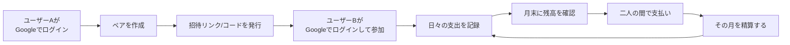

# ペアライフ 要件定義書

| 項目 | 内容 |
|---|---|
| 文書バージョン | 0.1（たたき台） |
| 作成日 | 2026-10-11 |
| 作成者 | ryu |
| ステータス | ドラフト |

> 本書は **初回リリース（家計簿のみ）** の要件を定める。

---

## 1. はじめに

### 1.1 背景

二人で暮らしていると、立て替えの記録と精算、家事分担の偏り、買い物・やることの共有など、二人の間で管理したいことが多い。これらを1つのアプリで扱える二人組専用のサービスとして「ペアライフ」をリリースする。

### 1.2 目的

- 二人組が、日々の立て替えの記録と精算を手軽に行えるようにする
- 不特定多数のペアが安全に使えるよう、認証・データ分離・運用体制を備えたサービスとして提供する

### 1.3 リリース方針

- 機能を段階的に追加していく
- 初回リリースは **家計簿（割り勘の記録と精算）だけ** の最小構成とし、早く公開して利用者の反応を見る
- サービスは無料で提供する（広告・有料プランは設けない）
- 2回目以降に追加する機能の候補は「[10. 次期以降の機能候補](#10-次期以降の機能候補)」にまとめる

---

## 2. スコープ

### 2.1 対象ユーザー

- **二人組**（夫婦、カップル、同棲・ルームシェアの2人など）
- 1つのペアは **必ず2人**。3人以上のグループは対象外
- 想定する利用端末は主にスマートフォン

### 2.2 初回リリースの範囲

| 機能群 | 概要 |
|---|---|
| アカウント | Google アカウントでのログイン、退会 |
| ペア | 招待、参加、解消 |
| 家計簿 | 立て替えの記録、残高表示、月ごとの精算 |
| 設定 | 表示名、テーマカラー |
| サービス共通 | 利用規約、プライバシーポリシー、問い合わせ |

---

## 3. 用語定義

| 用語 | 定義 |
|---|---|
| ユーザー | Google アカウントでペアライフにログインした個人 |
| ペア | 2人のユーザーで構成されるデータ共有の単位。家計簿のデータはすべてペアに属する |
| パートナー | 同じペアに所属するもう一方のユーザー |
| 支払者 | 支出を立て替えたユーザー |
| 割り勘 | 支出額を2人で折半する計上方法。残高には支出額の 1/2 が計上される |
| 全額請求 | 支出額の全額を相手に請求する計上方法。残高には支出額がそのまま計上される |
| 残高 | 対象月の未精算記録から算出した、どちらがいくら相手に払うべきかの金額 |
| 精算 | 対象月の記録をすべて精算済みにし、残高計算から外す操作 |

---

## 4. 業務フロー（利用の流れ）

二人の間の実際の支払い（現金・送金アプリなど）はアプリの外で行い、支払いが済んだらアプリ上で精算する。

---

## 5. 機能要件

優先度は次の3段階とする。

- **必須**: 初回リリースに必須
- **推奨**: できれば初回リリースに入れる
- **任意**: 余裕があれば入れる。間に合わなければ次期以降へ回す

### 5.1 アカウント

| 要件 | 優先度 | 備考 |
|---|---|---|
| Google アカウントでログインできる。初めてログインしたときにユーザーを作成する | 必須 | ログイン手段は Google だけとする |
| ログアウトできる | 必須 | |
| 一度ログインすれば、一定期間はログインし直さずに使える | 必須 | |
| アプリで保持するユーザー情報は、Google アカウントの識別子・表示名・テーマカラーだけとする | 必須 | メールアドレス、Google の氏名やプロフィール画像は保持しない。Google に要求する権限も最小限にする |
| 表示名とテーマカラーを設定できる | 必須 | 初回ログイン時に入力する。二人を見分けるために使う |
| 退会できる。退会すると本人のユーザー情報を削除する | 必須 | ペアのデータの扱いは 5.5 データの保持 |

### 5.2 ペア

| 要件 | 優先度 | 備考 |
|---|---|---|
| ユーザーはペアを作成できる | 必須 | |
| ペアの作成者は招待リンク（または招待コード）を発行できる | 必須 | 有効期限付き・1回だけ使えるものとする。メールでは送らず、ユーザーが LINE などで相手に渡す |
| 招待を受けたユーザーは、Google アカウントでログインしたうえでペアに参加できる | 必須 | |
| 1ユーザーが所属できるペアは1つ、1ペアの人数は最大2人とする | 必須 | |
| ペアを解消できる | 必須 | 解消後のデータの扱いは 5.5 データの保持 |
| パートナーが参加する前でも、1人で記録を始められる | 必須 | |

### 5.3 家計簿

| 要件 | 優先度 | 備考 |
|---|---|---|
| 支出を記録できる。項目は日付・金額・内容・支払者・計上方法（割り勘 / 全額請求） | 必須 | 支払者の初期値はログイン中のユーザー。計上方法の初期値は割り勘 |
| 複数の記録を端末上に一時保存し、まとめて登録できる | 必須 | 通信が失敗しても一時保存した内容は消えない |
| 記録を編集・削除できる | 必須 | 一覧の行をタップして編集画面を開く |
| 月を切り替えて記録を一覧表示できる | 必須 | 矢印ボタンと左右スワイプで切り替える |
| 表示中の月の残高（どちらがいくら払うか）を表示する | 必須 | 未精算の記録だけを対象とする。割り勘は 1/2、全額請求は全額で計上する |
| 月を精算できる。精算すると、その月の記録がすべて精算済みになる | 必須 | 実行前に確認ダイアログを出す |
| 精算済みの月には記録を追加・編集・削除できない | 必須 | サーバー側でもブロックする |
| 精算を取り消せる | 必須 | |

### 5.4 共通

| 要件 | 優先度 | 備考 |
|---|---|---|
| ホーム画面に追加して、アプリのように起動できる（PWA） | 必須 | |
| 通信中は二重操作を防ぎ、失敗したらエラーを表示する | 必須 | |
| 二人が同時に操作してもデータが壊れない | 必須 | |
| 利用規約・プライバシーポリシーを表示し、登録時に同意を得る | 必須 | |
| 問い合わせ窓口を用意する | 必須 | アプリからメールは送らない。外部のフォームサービスなどを使う |

### 5.5 データの保持

| 要件 | 優先度 | 備考 |
|---|---|---|
| 精算済みの記録は、記録の日付から18ヶ月が過ぎたら自動で削除する | 必須 | 月に1回、自動で実行する |
| 未精算の記録は、期間が過ぎても自動では削除しない | 必須 | 精算前のデータを誤って消さないため |
| 片方が退会またはペアを解消しても、ペアの家計簿データは削除しない。残った人は引き続き使える | 必須 | 削除は上の保持期間のルールに従う |
| 二人とも退会し、所属する人がいなくなったペアのデータは削除する | 必須 | |

---

## 6. 非機能要件

### 6.1 対応環境

- スマートフォン: iOS Safari、Android Chrome の最新版と1つ前のメジャーバージョン
- PC: Chrome、Edge、Safari、Firefox の最新版（スマホ向けレイアウトのままで表示できればよい）
- 画面の向きは縦向きを基本とする

### 6.2 性能・規模

| 要件 | 備考 |
|---|---|
| 画面操作に対するAPIの応答は、95パーセンタイルで1秒以内とする | |
| 家計簿画面は、4G回線で3秒以内に表示する | |
| 想定規模: リリース後1年で100ペア | 性能テストの目標値になる |
| 利用者の増加に合わせて、大きな改修なしに拡張できる構成とする | |

### 6.3 可用性

| 要件 | 備考 |
|---|---|
| 稼働率の目標は月間 99.5% とする（計画メンテナンスを除く） | 個人運営なので過度な目標は置かない |
| 計画メンテナンスは事前に告知する | |

### 6.4 セキュリティ

- 通信はすべて HTTPS とする
- アプリでパスワードを持たない。認証は Google に任せ、アプリ側では Google が発行したトークンを検証する
- APIはすべて認証必須とし、自分が所属するペアのデータにしかアクセスできないことをサーバー側で保証する
- 認証情報・APIキーなどの秘密情報をソースコードやリポジトリに含めない（リポジトリは Public）
- 大量リクエストを制限する（レート制限、WAF など）
- 入力値はサーバー側で検証する。XSS・インジェクションなど OWASP Top 10 の対策を行う
- 保存データは暗号化する
- 運営者が業務上必要な範囲を超えてユーザーデータを閲覧しない

### 6.5 データ保全

| 要件 | 備考 |
|---|---|
| データは自動でバックアップする | |
| 目標復旧時点（RPO）は24時間以内 | |
| 目標復旧時間（RTO）は24時間以内 | |

### 6.6 運用・保守

- アプリケーションのログを一定期間保存する。ログに個人情報やトークンを出力しない
- インフラはコードで管理する（IaC）
- テストとデプロイを自動化する（CI/CD）
- AWS の月額費用は5,000円以下とし、超えそうになったら通知する

### 6.7 拡張性

- 次期以降の機能（10章）を、既存の家計簿機能に大きく手を入れずに追加できる構成とする

### 6.8 ユーザビリティ

- よく使う操作は少ないタップで済むようにする（まとめて登録、タップで編集、スワイプで月切り替え）
- 初めて使う人が、説明を読まずに登録・ペア作成・最初の記録まで進める
- 文字サイズ・コントラストなど、基本的なアクセシビリティに配慮する

---

## 7. システム要件・制約

- インフラは AWS を使う
- ソースコードとドキュメントは GitHub のリポジトリ `Ryu2013/pairlife`（Public）で管理する
- 開発・運用は個人で行う。そのため、運用の手間が少ない構成（マネージドサービス・サーバーレス）を優先する
- 具体的な AWS サービスの選定は基本設計で行う
- 認証は Google アカウントによるログイン（OAuth 2.0 / OpenID Connect）だけとする
- メールサーバーを持たず、アプリからメールを送らない（費用を抑えるため）

---

## 8. 法務・コンプライアンス

| 要件 | 備考 |
|---|---|
| 利用規約を用意する | |
| プライバシーポリシーを用意する（個人情報保護法に対応） | |
| アクセス解析を使う場合は、外部送信規律（電気通信事業法）に対応する | |
| Google ログインの同意画面に必要なもの（アプリ名、プライバシーポリシーと利用規約の URL、独自ドメインなど）を用意する | Google の審査（ブランド確認）がある |

---

## 9. 前提条件

- ユーザーはスマートフォンと Google アカウントを持っている
- Google アカウントを持たない人は利用できない（初回リリースでは対象外とする）

---

## 10. 次期以降の機能候補

初回リリースの範囲外とする。追加するときに、あらためて要件を定義する。

| 候補 | 概要 |
|---|---|
| 家計簿グラフ | 月ごとの支出合計の推移。ユーザー別・カテゴリ別の内訳 |
| 買い物リスト | 二人で共有する買い物リスト。購入済みの項目は一定期間で自動削除 |
| やることリスト | 二人で共有する ToDo。完了した項目は一定期間で自動削除 |
| 家事管理 | 家事にポイントを付けて記録し、月ごとに締める。ポイント差を割引として家計簿に反映する |
| 利用機能の選択 | 機能が増えた段階で、ペアごとに使う機能を選べるようにする（例: 家事管理だけ使う） |
| 支出のカテゴリ | 食費・日用品などのカテゴリを支出に付ける |
| 割り勘比率の指定 | 折半以外の比率（例: 6:4）で計上する |
| Google 以外のログイン | Apple アカウントなど、Google 以外でのログイン |
| リアルタイム反映 | パートナーの変更を、再読み込みしなくても画面に反映する |
| お知らせ | 新機能やメンテナンスのお知らせを表示する |

---

## 改訂履歴

| バージョン | 日付 | 内容 |
|---|---|---|
| 0.1 | 2026-10-11 | たたき台を作成 |
